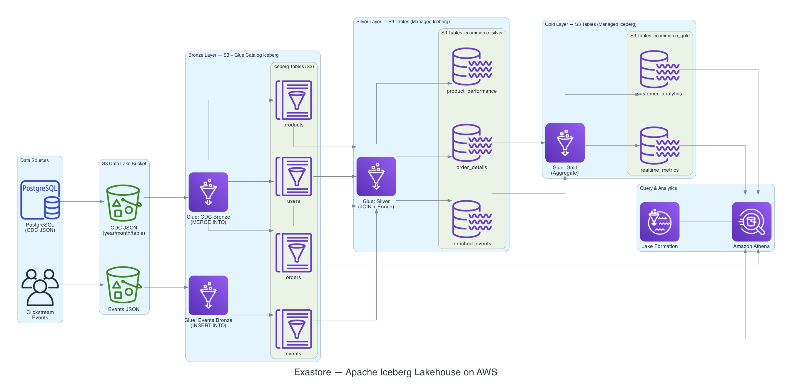
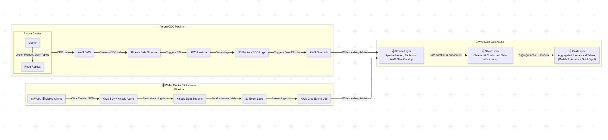

# Exastore: Apache Iceberg Lakehouse on AWS

Portfolio project by [Charan Konduri](https://github.com/sricharan97) — a medallion-architecture lakehouse (Bronze → Silver → Gold) for Exastore’s e-commerce data, built with Apache Iceberg, AWS Glue 5.0, S3 Tables, and Athena. It ingests PostgreSQL CDC records (Debezium JSON) and website clickstream events, then produces business-ready metrics and demonstrates Iceberg snapshots and time travel.

## Architecture



```
CDC JSON (S3)    ──→  Glue: CDC Bronze    ──→  S3 Iceberg (orders, users, products)
Events JSON (S3) ──→  Glue: Events Bronze ──→  S3 Iceberg (events)
                      Glue: Silver Layer  ──→  S3 Tables  (order_details, enriched_events, product_performance)
                      Glue: Gold Layer    ──→  S3 Tables  (customer_analytics, realtime_metrics)
                      Athena + Lake Formation for querying every layer
```

Conceptual end-to-end flow (Aurora/DMS/Kinesis upstream; lab work starts from JSON already on S3):



| Layer | Storage | Tables | Technique |
|-------|---------|--------|-----------|
| Bronze | S3 + Glue Catalog Iceberg | orders, users, products, events | CDC `MERGE INTO`, append-only `INSERT INTO` |
| Silver | S3 Tables (managed Iceberg) | order_details, enriched_events, product_performance | Joins, window functions, aggregations |
| Gold | S3 Tables (managed Iceberg) | customer_analytics, realtime_metrics | Monthly and hourly business aggregations |

## Project Structure

```
project.ipynb          Orchestration notebook: configure, upload, run jobs, validate, explore Iceberg
glue-jobs/
  cdc-batch/           CDC Bronze job (MERGE INTO)
  events/              Events Bronze job (INSERT INTO with data quality checks)
  silver/              Silver enrichment job
  gold/                Gold aggregation job
datasets/              CDC and clickstream JSON data
docs/architecture/     Architecture diagrams
```

## Local Setup

Requirements: **Python 3.9+**, `boto3`, `pandas`, and an AWS account with Glue, S3, S3 Tables, Athena, and Lake Formation access.

1. Clone this repo and create a virtualenv (optional but recommended).
2. Install dependencies: `pip install -r requirements.txt`
3. Configure AWS credentials locally (never commit keys or tokens):

   ```bash
   aws configure
   # or use SSO / environment variables / an IAM role
   aws sts get-caller-identity
   ```

4. Open `project.ipynb` and set `ACCOUNT_ID` (and related names if your resources differ). Bucket placeholders follow `ecommerce-analytics-datalake-dev-YOUR_ACCOUNT_ID` and `ecommerce-analytics-gold-dev-YOUR_ACCOUNT_ID`.
5. Run the notebook top to bottom: register the S3 Tables catalog, upload scripts/datasets, then execute Bronze → Silver → Gold and the Iceberg validation cells.

**Do not commit** `.env` files, AWS credential files, or access keys. Temporary session credentials expire — refresh them and restart the notebook kernel if you see `ExpiredToken` / `InvalidClientTokenId`.

## Design Decisions

### Bronze: CDC (`iceberg-cdc-bronze-layer.py`)
- **Schemas** hold all business columns plus CDC metadata: `op`, `ts_ms`, `source_lsn`, `_processed_at`.
- **Primary keys** use `COALESCE(after.<pk>, before.<pk>)`, so delete records (where `after` is null) still carry a key.
- **Deduplication** uses `ROW_NUMBER() OVER (PARTITION BY <pk> ORDER BY source_lsn DESC, ts_ms DESC)` and keeps `_rn = 1`. Only the latest change per key is merged.
- **`MERGE INTO`** has three branches: matched + `op = 'd'` → `DELETE`; matched → `UPDATE SET *`; not matched and not a delete → `INSERT *`.
- **Tables** are Iceberg format-version 2, Parquet with Snappy compression, and use hidden partitioning:
  `days(created_at)` for orders, `months(created_at)` for users and products.

### Bronze: Events (`iceberg-events-bronze-layer.py`)
- Events are append-only, so the job inserts and does not merge.
- A single-pass quality check logs invalid event types, future timestamps and null `user_id` values. It logs
  issues and does not fail the job. Only valid records (`page_view`, `add_to_cart`, `purchase`, `click`,
  non-future timestamp, `user_id >= 1`) are written.
- Partitioned by `(year, month)`.

### Silver (`iceberg-silver-layer.py`)
- Uses `SparkSession.builder` with `s3tablescatalog` registered as a `GlueCatalog` pointing at the S3 Table Bucket.
- The namespace is created through the Glue API (`boto3`), because Spark SQL cannot create S3 Tables namespaces.
- `create_silver_table()` runs the query, then `DROP TABLE ... PURGE` (required by S3 Tables), then
  `df.writeTo(fqn).using("iceberg").tableProperty("format-version", "2").create()`. This makes the job re-runnable.
- `order_details`: orders joined to users, with window functions for `customer_order_sequence` and
  `customer_lifetime_value`, plus `order_value_segment` and `customer_segment`
  (New = 1 order, Repeat ≤ 3, Loyal ≤ 10, VIP otherwise).
- `enriched_events`: events left-joined to users and products, with session sequence and time features.
  `revenue` is the product price on purchase events, falling back to the event's `order_value` when the
  product is not in the catalog.
- `product_performance`: products left-joined to events, aggregated per product (page views, purchases,
  conversion rates, with divide-by-zero guards).

### Gold (`iceberg-gold-layer.py`)
- Same catalog and write pattern as silver.
- `customer_analytics`: `order_details` aggregated by month (customer counts, revenue, segment breakdowns,
  geography). Orders with no creation date are excluded so every row is a real month.
- `realtime_metrics`: `enriched_events` aggregated by hour (event counts, traffic sources, revenue).

## Validation Results

| Check | Result |
|-------|--------|
| Bronze row counts | orders 2,131 · users 912 · products 391 · events 498 |
| Duplicate order IDs | 0 |
| Event types | page_view 208 · add_to_cart 120 · purchase 93 · click 77 |
| Silver row counts | order_details 2,024 · enriched_events 498 · product_performance 391 |
| Customer segments | New, Repeat, Loyal and VIP, all with non-zero orders and average value |
| Product categories | 5 shown with views, purchases and conversion rate |
| Gold `customer_analytics` | 13 monthly rows, 2024-12 to 2025-12 |
| Gold `realtime_metrics` | Hourly rows with non-zero revenue |

## Iceberg Features

- **Snapshots.** `orders$snapshots` and `orders$history` show two snapshots: an initial `append` (2,133 records)
  and an `overwrite` from the supplemental CDC load, with the second snapshot's parent pointing to the first.
- **Time travel.** `FOR TIMESTAMP AS OF` the first snapshot's `committed_at` returns the table as it was
  before the supplemental load:

  | Version | Rows | Revenue |
  |---------|------|---------|
  | Historical (first snapshot) | 2,133 | 556,462.16 |
  | Current | 2,131 | 555,744.83 |

  The supplemental CDC data contains 3 updates and 2 deletes on `orders`, which explains the difference.

## Notes on the Data

- The event data only references product IDs 1–10, while the product catalog covers IDs 3–420. At most 8
  products can therefore have activity, so some categories (Home & Garden, Clothing) show zero views and
  purchases. The join logic is correct. The source data does not link to those products.
- Silver `order_details` has fewer rows than bronze `orders` because it is an inner join to users and was built
  before the supplemental load. Silver and gold reflect the state at that point.
- The supplemental CDC file is copied inside S3 into the `year=/table_name=` layout the job expects, then the
  CDC job runs with its input path overridden (see the "Supplemental CDC Load" cell in the notebook).

## Running the Pipeline

1. Set `ACCOUNT_ID` / `BUCKET` / `ATHENA_WORKGROUP` / `TABLE_BUCKET_NAME`, then register `s3tablescatalog` (Steps 1–2).
2. Upload the scripts and datasets (Step 3), and define the helpers (Step 4).
3. Run bronze, silver and gold in order (Steps 5, 7, 9), validating after each layer.
4. Run the supplemental CDC load, then inspect snapshots and run the time-travel query.

The silver and gold jobs are re-runnable, because each drops and recreates its tables. The events job is
append-only and the supplemental load adds a snapshot, so run each of those only once.

## AWS Services Used

- **AWS Glue** — Spark ETL jobs for each medallion layer
- **Amazon S3** — raw data and Bronze Iceberg tables
- **S3 Tables** — managed Iceberg for Silver and Gold
- **Amazon Athena** — SQL validation and metadata queries
- **AWS Lake Formation** — access control
- **Apache Iceberg** — `MERGE INTO`, hidden partitioning, snapshots and time travel
